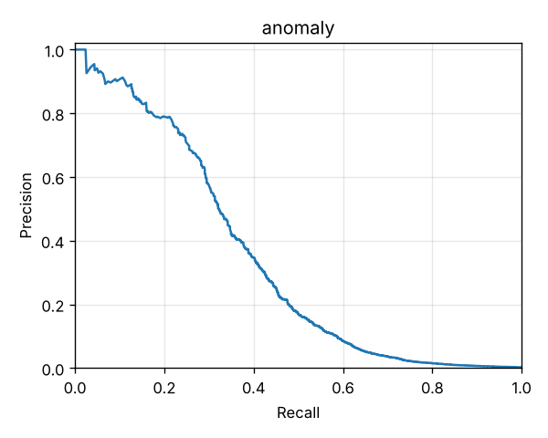
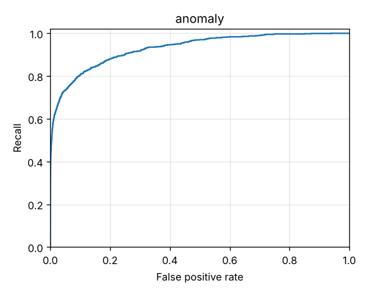

# Anomaly score (Isolation Forest)

An Isolation Forest trained on days 0–45 with no labels at all, judged on the same evaluation days (90–120) as the [rules-only baseline](rules-only.md). Its High band is set so that days 60–90 give the Alert budget of 100 a day. Here the Risk score is just the Anomaly score × 100. Combining it with the rules is #11.

Reproduce with:

```bash
make generate
uv run txrisk features --out data/features/features.parquet
uv run txrisk evaluate --scorer anomaly --features data/features/features.parquet
uv run txrisk evaluate --scorer lof --features data/features/features.parquet
```

Full numbers are in [anomaly/metrics.json](anomaly/metrics.json) and [lof/metrics.json](lof/metrics.json).

The Isolation Forest numbers include the two inputs added in #46 (`amount_to_largest_cash_in_30d` and `received_from_counterparty_24h`). The LOF comparison was not rerun with them.

## Against the rules

| | Rules only | Anomaly score | LOF (comparison) |
|---|---|---|---|
| PR-AUC | **0.487** | 0.339 | 0.008 |
| ROC-AUC | 0.891 | **0.930** | 0.462 |
| High a day | 13.4 | 184 | 373 |
| Precision / recall at High | **0.83** / 0.34 | 0.10 / **0.58** | 0.01 / 0.09 |
| Precision at the Alert budget (top 100 a day) | **0.205** | 0.169 | 0.019 |
| Recall at High, against discovered labels | 0.46 | **0.67** | — |

 

## By Fraud scenario (recall at High)

| Scenario | Rules only | Anomaly score |
|---|---|---|
| Account takeover drain | 0.62 | **0.74** |
| SIM-swap takeover | 0.32 | **0.69** |
| Social-engineering push | 0.10 | **0.85** |
| Agent structuring | 0.58 | **0.67** |
| Mule fan-in | **0.12** | 0.11 |
| Reversal scam | **0.48** | 0.02 |

## What this says

- **On its own, the Anomaly score ranks fraud worse than the rules** (PR-AUC 0.34 against 0.49), and it raises far more false alarms. Unusual is not the same as fraud.
- **It catches fraud the rules can't.** It finds 85% of Social-engineering pushes, against 10%. It also holds up through the day-100 drift: SIM-swap takeover recall is 69%, where the rules fall to 32%. The two components find different fraud, which is the case for stacking them in #11.
- **It over-alerts, and Easter is the main reason.** The threshold was set to give 100 a day on days 60–90, but the evaluation days average 184. The extra is concentrated on days 92–96, which is 3–7 April, the Easter festive season the generator makes busier and spendier. Peak days reach 573 High Alerts. That's a Benign anomaly doing exactly what it was designed to do. Outside Easter it settles to about 85–250 a day, creeping up as the market grows. Drift monitoring (#20) exists to watch this kind of shift.
- **Mule fan-in and the Reversal scam stay invisible to it.** In both, each single Transaction looks ordinary: a victim pays a stranger a normal amount. Only the pattern across Wallets gives it away. `received_from_counterparty_24h` describes that pattern for the Reversal scam, but it is almost always 0 in training, so the forest never learns to isolate on it. `RETURN_TO_NEW_SENDER` uses it instead.
- **LOF is no better than chance here**, with ROC-AUC 0.46, even with every input rescaled first. Dropping the inputs that grow over time (Wallet age, history count) changed nothing: LOF stayed at chance and the Isolation Forest went to 185 High a day. LOF also has to compare every scored Transaction with its neighbours, so it was only ever an offline comparison. The Isolation Forest is the one that is served.
- **Segments:** the false positive rate at High is 0.5–3.9% across segments. It's highest for Wallets under 30 days old (3.9%, up from 2.4% before #46). Being new is itself unusual. No fraud in this window targets them. It's also higher in the App than on USSD (1.5% against 0.7%). The stacked score in #11 should be checked against these, not the raw Anomaly score.
