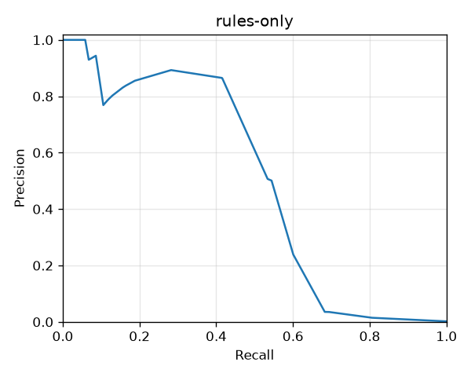
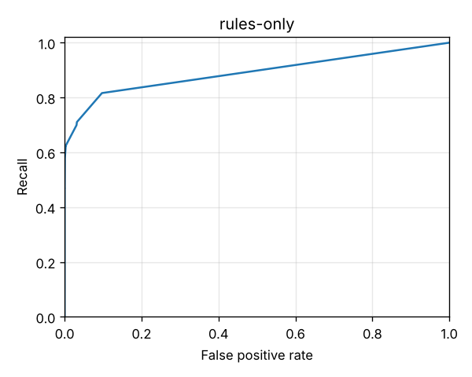

# Rules-only baseline

The nine rules in `config/rules.toml`, on their own, judged on the evaluation split (days 90–120 of the default dataset, seed 42). This is the bar the models in #9–#11 have to beat.

Reproduce with:

```bash
make generate
make evaluate
```

Full numbers are in [rules-only/metrics.json](rules-only/metrics.json).

## Headline

| | |
|---|---|
| Transactions evaluated | 533,625 over 30 days |
| Fraud (Ground truth) | 974 Transactions (0.18%) |
| ROC-AUC / PR-AUC | 0.884 / 0.451 |
| **High band** | **308 Alerts, 10.3 a day: precision 0.89, recall 0.28**, false positive rate 0.006% |
| Medium or High | 18,789 (626 a day): precision 0.035, recall 0.68 |
| Precision at the Alert budget (top 100 a day) | 0.197 |
| Recall at High, against Ground truth | 0.28 |
| Recall at High, against discovered labels | 0.43 (of the 302 frauds the operation would have found by day 120) |

 

## By Fraud scenario (recall at High)

| Scenario | Fraud Transactions | Recall |
|---|---|---|
| Account takeover drain | 180 | 0.62 |
| SIM-swap takeover | 383 | 0.32 |
| Agent structuring | 48 | 0.19 |
| Mule fan-in | 144 | 0.12 |
| Social-engineering push | 138 | 0.10 |
| Reversal scam | 81 | 0.00 |

## What this says

- **When the rules say High, they are nearly always right.** About nine in ten High Alerts are fraud, but they find only about a quarter of it. The Alert budget allows 100 a day, and the rules fill only about 10 of those slots with confident Alerts.
- **Drift is already visible.** Over the whole 120 days the rules catch about 71% of SIM-swap takeovers at High. In this window it is 32%. From day 100, fraudsters wait 24–72 hours after the SIM swap and take 20–40% at a time, which slips under `SIM_SWAP_DRAIN` (within 24h, at least 50%). That is the drift monitoring and retraining in #20–#21 are meant to catch.
- **Rules can't see the victim's side.** For Mule fan-in and Agent structuring, only the mule's Cash-outs and the structured Cash-outs fire. The victims' Transfers and the loading Cash-ins look ordinary on their own.
- **Scams where the victim acts are invisible to rules.** Social-engineering push and the Reversal scam happen from the victim's own phone and Channel. Only one medium rule (`FIRST_TIME_LARGE_TRANSFER`) ever touches them. This is where the Anomaly score and the supervised model have to add value.
- **The Medium band is too noisy to work.** It holds 18,789 Transactions with 3.5% precision. Thresholds derived from the Alert budget (#11) replace these fixed bands.
- **Segments:**
  - No segment stands out as unfairly flagged. The false positive rate at High is at most 0.014%, in the enhanced KYC tier.
  - No fraud in this window targets Wallets under 30 days old, because victims are drawn from Wallets that already existed.
  - Recall is lower on USSD (0.22) than in the App (0.34).
