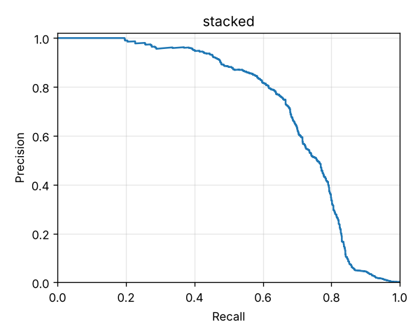
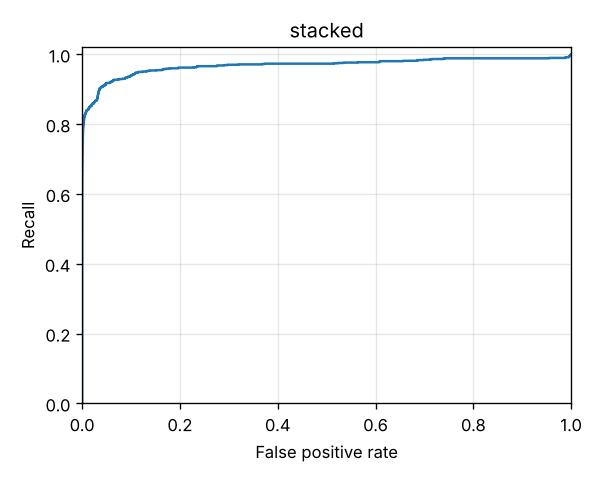

# Stacked Risk score

The model bundle (#11), judged on the same evaluation days (90–120 of the default dataset, seed 42) as the [rules-only baseline](rules-only.md), the [Anomaly score](anomaly.md) and the [supervised fraud probability](supervised.md). A logistic regression stacks the three components into one Risk score:

- **Rules:** the rules score, 0–1.
- **Anomaly:** the Anomaly score, 0–1.
- **Supervised:** the supervised model's raw probability, as log-odds.

The two models train on days 0–45. The stacker is fitted on days 45–60, with only the Fraud labels known on day 90 (ADR 0007, ADR 0008). The High band is set so that days 60–90 give the Alert budget of 100 a day, as for every other scorer, and Medium covers the next 3× that volume. Critical rule hits use up their share of the budget first, because they are High whatever their score.

Reproduce with:

```bash
make generate
uv run txrisk features --out data/features/features.parquet
uv run txrisk evaluate --scorer stacked --features data/features/features.parquet
# The same bundle, saved to models/<version>/ and recorded in MLflow (mlflow.db, mlruns/):
uv run txrisk train --features data/features/features.parquet
```

Full numbers are in [stacked/metrics.json](stacked/metrics.json).

## What the Risk score means

**The Risk score is the chance of discovered fraud × 100, not the chance of fraud.** The stacker learns from Fraud labels, and an undiscovered fraud counts as legitimate, so its probability inherits the same target as the supervised model's calibration. Here, only about two frauds in three are ever discovered. Correcting for that would need the discovery rate, which only Ground truth knows, and Ground truth may not reach training (ADR 0007). So no correction is applied.

At a fraud rate of about 0.2%, most scores are far below 1. High starts at a Risk score of **0.17**, and Medium at 0.094. The Risk score therefore keeps two decimals; rounded to whole numbers, nearly every alert would read 0. A Critical rule hit raises the score to at least the High threshold.

## The stacker's weights

| Component | Weight (log-odds per unit) |
|---|---|
| Rules score (0–1) | 7.24 |
| Anomaly score (0–1) | 1.27 |
| Supervised log-odds | 0.35 |
| Intercept | −6.23 |

- **The rules count for much more than their PR-AUC suggests.** One High-severity hit (a rules score of 0.5) adds 3.6 to the log-odds, and a Critical hit (0.9) adds 6.5. When a rule fires, it is right far more often than its coarse ranking shows.
- **The supervised model's log-odds are scaled down by about two thirds.** It is class-weighted, so its raw log-odds are overconfident. The stacker learns its own scaling for them, which is why it takes the raw probability rather than the calibrated one.
- **The Anomaly score adds a little.** Going from a typical Transaction (0.5) to the most unusual (1.0) adds about 0.64 to the log-odds.

## Against each component alone

| | Rules only | Anomaly score | Supervised only | Stacked |
|---|---|---|---|---|
| PR-AUC | 0.451 | 0.257 | 0.708 | **0.712** |
| ROC-AUC | 0.884 | 0.906 | 0.921 | **0.968** |
| High a day | 10.3 | 213 | 120 | 114 |
| Precision / recall at High | **0.89** / 0.28 | 0.08 / 0.54 | 0.22 / 0.82 | 0.24 / **0.82** |
| Precision at the Alert budget (top 100 a day) | 0.197 | 0.152 | 0.260 | **0.265** |
| Recall within the Alert budget (top 100 a day) | 0.61 | 0.47 | 0.80 | **0.82** |
| Recall at Medium or higher | 0.68 | 0.66 | **0.89** | 0.86 |
| Recall at High, against discovered labels | 0.43 | 0.61 | 0.88 | **0.90** |

 

## By Fraud scenario

Recall at each scorer's own High band, and within the top 100 a day.

| Scenario | Fraud | Rules at High | Anomaly at High | Supervised at High | Stacked at High | Supervised, top 100 | Stacked, top 100 |
|---|---|---|---|---|---|---|---|
| SIM-swap takeover | 383 | 0.32 | 0.66 | **0.90** | 0.86 | **0.90** | 0.86 |
| Account takeover drain | 180 | 0.62 | 0.69 | 0.95 | **0.99** | 0.94 | **0.98** |
| Mule fan-in | 144 | 0.12 | 0.09 | 0.72 | **0.74** | 0.62 | **0.72** |
| Social-engineering push | 138 | 0.10 | 0.74 | 0.96 | **1.00** | 0.96 | **1.00** |
| Reversal scam | 81 | 0.00 | 0.00 | **0.41** | 0.37 | **0.40** | 0.38 |
| Agent structuring | 48 | 0.19 | **0.65** | 0.29 | 0.42 | 0.27 | **0.40** |

## Reliability: is the probability honest?

The stacker's own probability is the Risk score ÷ 100 before the Critical floor. Here it is checked just as the supervised probability was. Lower is better for both measures; ECE is the expected calibration error over ten equal-width bins.

| Against | Probability | Brier score | ECE |
|---|---|---|---|
| Eventual Fraud discovery (what both are fitted to) | supervised, calibrated | **0.000733** | **0.00048** |
| | stacked | 0.000833 | 0.00059 |
| Ground truth | supervised, calibrated | **0.001052** | **0.00105** |
| | stacked | 0.001193 | 0.00111 |

- **The stacked probability is a little less honest than the supervised one, though it ranks better.** It understates the mid-range. In its 0.1–0.2 bin, 46% of Transactions are eventually discovered as fraud, and 70% in its 0.2–0.3 bin. A logistic stacker can only scale and shift log-odds, while centred isotonic calibration can bend.
- **Against Ground truth it runs lower still.** That is the discovery gap from [What the Risk score means](#what-the-risk-score-means): the price of training only on what the operation would know (ADR 0007).
- If the Risk score is ever read as a probability rather than as a rank, recalibrating the stacked output on the calibration days with centred isotonic regression is the next step. Both judge scorers at the Alert budget, which depends only on rank.

## Reasons

Each Risk assessment gives up to three Reasons. Critical rule hits come first; after that comes whatever pushed the Risk score's log-odds up most:

- **A Rule hit** counts for its share of the rules' push, split by severity weight.
- **A model input** counts for its TreeSHAP contribution, weighted as the stacker weighs its model:
  - For the supervised model, this is LightGBM's own contribution to the raw log-odds.
  - For the Isolation Forest, SHAP explains the average path length. Unusualness is 2^(−path length / c), so each Transaction's rise in Anomaly score above a typical one is shared out in proportion to its path-length contributions.
- **Inputs that measure what a rule measures** share its code (`AMOUNT_VS_MEDIAN`, `NEAR_KYC_LIMIT`, `NEW_REGION`, `AGENT_STRUCTURING`). They become one Reason, in the rule's words.
- **Inputs that only say what kind of Transaction it is** (its type, channel and direction) give no Reason.

The riskiest evaluation Transactions, by scenario:

| Scenario | Risk score | Reasons |
|---|---|---|
| SIM-swap takeover | 99.29 | `SIM_SWAP_DRAIN` Moved 99% of the balance 11.7 hours after a SIM swap · `RECEIVER_FAN_IN` The receiving Wallet got money from 5 different Wallets in 24 hours · `AMOUNT_VS_MEDIAN` Amount is 5.2x this Wallet's 30-day median |
| Account takeover drain | 95.37 | `NEW_DEVICE_BURST` 3 Transfers to new Counterparties within an hour, from a device first used 15 minutes ago · `AMOUNT_VS_MEDIAN` Amount is 6.1x this Wallet's 30-day median · `FIRST_TIME_LARGE_TRANSFER` Transfer of 6.1x the usual amount to a first-time recipient |
| Mule fan-in | 91.54 | `RECEIVER_FAN_IN` The receiving Wallet got money from 17 different Wallets in 24 hours · `MULE_CASHOUT` Cash-out after receiving from 17 different Wallets in 24 hours · `AMOUNT_VS_MEDIAN` Amount is 76.2x this Wallet's 30-day median |
| Social-engineering push | 84.33 | `LARGE_AMOUNT` Amount of 5,000 GHS · `AMOUNT_VS_MEDIAN` Amount is 78.3x this Wallet's 30-day median · `FIRST_TIME_LARGE_TRANSFER` Transfer of 78.3x the usual amount to a first-time recipient |
| Agent structuring | 17.56 | `AGENT_STRUCTURING` 5 Cash-outs just under the limit at this Agent in 24 hours · `AMOUNT_VS_MEDIAN` Amount is 16.0x this Wallet's 30-day median · `LARGE_AMOUNT` Amount of 978 GHS |
| Reversal scam | 15.18 | `AMOUNT_VS_MEDIAN` Amount is 8.2x this Wallet's 30-day median · `FIRST_TIME_LARGE_TRANSFER` Transfer of 8.2x the usual amount to a first-time recipient · `TIME_SINCE_LAST` 9 minutes since this Wallet's last Transaction |
| Legitimate | 66.48 | `SIM_SWAP_DRAIN` Moved 100% of the balance 0.1 hours after a SIM swap · `RECENT_SIM_SWAP` SIM swapped 5 minutes earlier · `AMOUNT_VS_MEDIAN` Amount is 6.1x this Wallet's 30-day median |

The legitimate one is a real owner who swapped their SIM and moved everything at once. It is exactly what `SIM_SWAP_DRAIN` exists to stop, and it is why that rule is Critical.

In a random 400 of the High alerts, every one had at least one Reason. The commonest first Reasons were:

- `AMOUNT_VS_MEDIAN` (257)
- `FIRST_TIME_LARGE_TRANSFER` (65)
- `SIM_SWAP_DRAIN` (23)
- `RECEIVER_FAN_IN` (19)

## Training and scoring time

Measured in one cloud container with nothing else heavy running:

| Step | Time |
|---|---|
| `txrisk train` with a saved feature table: both models, rule scores for 1.75M Transactions, stacker, thresholds, MLflow | 2 min |
| `txrisk evaluate --scorer stacked` with a saved feature table | 2 min |

Scoring one Transaction through `ScoringService.assess`, timed over 2,000 Transactions of a small market:

| | p50 | p95 |
|---|---|---|
| Rules only | 0.17 ms | 0.26 ms |
| Stacked, with Reasons | 50 ms | 67 ms |

Of the stacked time, about 15 ms goes on building the one-row model inputs, 14 ms on the components and the Risk score, and 16 ms on the SHAP contributions for the Reasons. This is well inside the 200 ms p95 target. The first assessment after loading a bundle also builds the Isolation Forest's SHAP explainer, which takes about 0.8 s once, so a server should warm it up before taking traffic.

## What this says

- **Stacking adds little to ranking but helps where the components disagree.** PR-AUC moves only from 0.708 to 0.712, but ROC-AUC rises from 0.921 to 0.968, and High holds as much fraud on fewer alerts (114 a day against 120). Most of the ranking already comes from the supervised model.
- **Agent structuring improves the most.** Recall at High rises from 0.29 to 0.42. The supervised model never sees a discovered structuring case. The rule and the Anomaly score both see this fraud, and the stacker learns to trust them.
- **SIM-swap takeover and the Reversal scam lose a little,** at 0.86 against 0.90 and 0.37 against 0.41. Both depend on the supervised model's generalisation:
  - The drifted SIM-swap pattern after day 100 waits too long for the SIM-swap rule to fire.
  - The Reversal scam never appears in training.

  The stacker scales the supervised model's log-odds down, so these lose some of their lead.
- **It still over-alerts at Easter.** High averages 114 a day, but it reaches 202–235 a day on days 92–95 (3–6 April), the busier, spendier festive season. Outside it, the daily count stays between 62 and 124.
- **Segments:**
  - The false positive rate at High is 0.42–0.65% across regions, tiers and channels.
  - It is highest for Wallets under 30 days old (1.11%), where no fraud falls in this window.
  - Recall is lowest on the enhanced tier (0.61) and over USSD (0.78 against 0.86 on the App).
