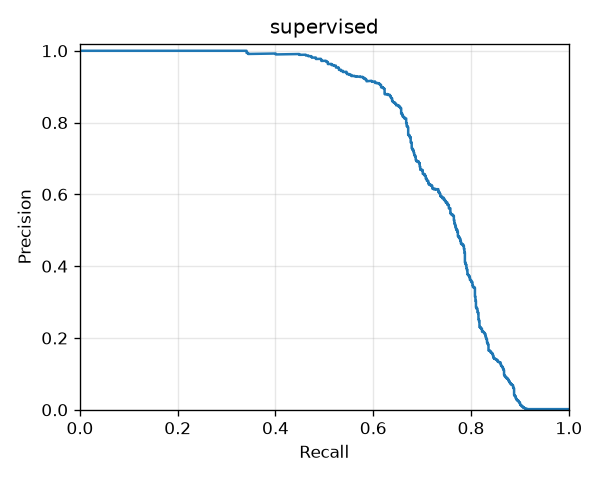
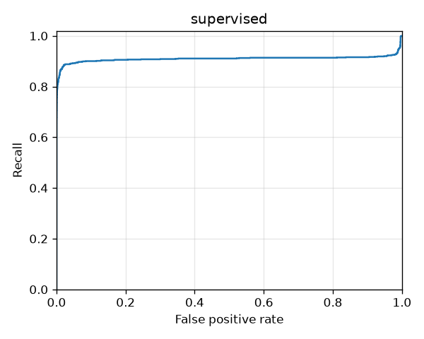

# Supervised fraud probability

A class-weighted LightGBM model with isotonic calibration (#10), judged on its own on the same evaluation days (90–120 of the default dataset, seed 42) as the [rules-only baseline](rules-only.md) and the [Anomaly score](anomaly.md). It trains on days 0–45 and is calibrated on days 45–60, both with only the Fraud labels known on day 90 (ADR 0007, ADR 0008). As with the Anomaly score, its High band is set so that days 60–90 give the Alert budget of 100 a day, and Medium covers the next 3× that volume. The Risk score is the calibrated probability × 100. Combining it with the other components is #11.

Reproduce with:

```bash
make generate
uv run txrisk features --out data/features/features.parquet
uv run txrisk evaluate --scorer supervised --features data/features/features.parquet
```

Full numbers are in [supervised/metrics.json](supervised/metrics.json).

**Calibration is centred isotonic, not plain isotonic.** Plain isotonic regression is a step function. Here it gave only 55 distinct probabilities across 533,625 Transactions, which threw away the ranking inside each step (PR-AUC 0.714 against the raw probability's 0.745). It also meant the Alert budget threshold could only take or leave a whole step: High came out at 246 a day against a budget of 100. Replacing each step with its centre point and joining the centres with straight lines, starting from no fraud at a raw probability of 0, keeps the same fit to the labels and keeps the classifier's whole ranking.

## Against the other components

| | Rules only | Anomaly score | Supervised only |
|---|---|---|---|
| PR-AUC | 0.451 | 0.257 | **0.745** |
| ROC-AUC | 0.884 | 0.906 | **0.910** |
| High a day | 10.3 | 213 | 124 |
| Precision / recall at High | **0.89** / 0.28 | 0.08 / 0.54 | 0.22 / **0.83** |
| Precision at the Alert budget (top 100 a day) | 0.197 | 0.152 | **0.264** |
| Recall within the Alert budget (top 100 a day) | 0.61 | 0.47 | **0.81** |
| Recall at High, against discovered labels | 0.43 | 0.57 | **0.84** |

 

## By Fraud scenario

Recall at each scorer's own High band, and within the top 100 a day. The second is the fairer comparison, because the rules' High band holds only about 10 a day. The rules' scores are coarse, so which of their tied Transactions fall inside the top 100 depends on Transaction order.

| Scenario | Fraud | Rules at High | Anomaly at High | Supervised at High | Rules, top 100 | Anomaly, top 100 | Supervised, top 100 |
|---|---|---|---|---|---|---|---|
| SIM-swap takeover | 383 | 0.32 | 0.66 | **0.90** | 0.52 | 0.57 | **0.88** |
| Account takeover drain | 180 | 0.62 | 0.69 | **0.93** | 0.83 | 0.62 | **0.93** |
| Mule fan-in | 144 | 0.12 | 0.09 | **0.81** | 0.40 | 0.08 | **0.80** |
| Social-engineering push | 138 | 0.10 | 0.74 | **0.91** | **0.99** | 0.63 | 0.91 |
| Reversal scam | 81 | 0.00 | 0.00 | **0.42** | 0.35 | 0.00 | **0.42** |
| Agent structuring | 48 | 0.19 | **0.65** | 0.31 | 0.42 | **0.58** | 0.27 |

## Reliability: is the probability honest?

Calibration is fitted to Fraud labels, and an undiscovered fraud counts as legitimate. So the calibrated probability estimates **the chance of fraud that gets discovered**, not the chance of fraud. In this window, 634 of the 974 frauds are ever discovered (65%). The report checks reliability against both targets. Lower is better for both measures; ECE is the expected calibration error over ten equal-width bins.

| Against | Probability | Brier score | ECE |
|---|---|---|---|
| Eventual Fraud discovery (what calibration targets) | raw | 0.000837 | 0.00069 |
| | **calibrated** | **0.000706** | **0.00039** |
| Ground truth | **raw** | **0.000741** | **0.00052** |
| | calibrated | 0.000904 | 0.00098 |

- **Against what it was fitted to, calibration helps.** Brier falls 16% and ECE by 44%. The raw probability overstates the mid-range: Transactions scoring 0.4–0.5 raw are discovered as fraud only 27% of the time. The calibrated probability tracks it: 0.47 on average in its 0.4–0.5 bin, against 57% discovered.
- **Against Ground truth, calibration makes it worse.** Fraud is found only about two times in three, so the calibrated probability runs low by about that factor: in its 0.4–0.5 bin, 90% of Transactions are really fraud. That is the label-delay gap ADR 0007 accepts on purpose, showing up in the probability itself.
- **The raw probability is close to Ground truth by luck, not design.** Most fraud here is cleanly separable, so the trees put it near 1 and almost everything else near 0. Of the 507 Transactions above 0.9 raw, 97% are fraud. Class weighting tilts the middle upwards, and on this data that happens to roughly offset the undiscovered fraud.
- **What to do about it is a decision for #11.** The stacker is refitted on days 45–60 with the same labels, so it inherits the same target. If the Risk score should mean "chance of fraud" rather than "chance of discovered fraud", it needs a discovery-rate correction. Nothing else can supply that, because Ground truth may not reach training.

## Training and scoring time

Measured on one laptop with nothing else heavy running:

| Step | Time |
|---|---|
| Feature table: all 1.75M Transactions replayed in time order (`txrisk features`) | 11–13 min |
| Training: labels, model inputs, LightGBM (100 trees) and calibration | 72–87 s |
| Batch scoring of the 533,625 evaluation Transactions | 5.4 s (about 10 µs each) |
| `txrisk evaluate --scorer supervised` with a saved feature table | under 2 min |

Scoring one Transaction through `ScoringService.assess`, timed over 2,000 Transactions of a small market:

| | p50 | p95 |
|---|---|---|
| Rules only | 0.27 ms | 0.63 ms |
| With the supervised component | 68 ms | 160 ms |

Nearly all of that difference is building the one-row model inputs (`inputs_for`, about 60 ms), not the model: the trees and calibration together take about 0.5 ms. `assess` builds them once when it has both the anomaly and supervised models. Serving latency work belongs in the shared model inputs.

## What this says

- **The model ranks fraud far better than either other component.** PR-AUC rises to 0.745, against 0.451 for the rules and 0.257 for the Anomaly score. Filling the same 100 Alerts a day, it finds 81% of fraud, against 61% for the rules.
- **It learns what the rules see from only one side.** Mule fan-in recall rises from 0.12 to 0.81, because the model also learns the victims' Transfers and loading Cash-ins that look ordinary to any single rule.
- **It holds up through the day-100 drift.** SIM-swap takeover recall is 0.90, against the rules' 0.32, even though the drifted pattern (waiting 24–72 hours, taking 20–40%) never appears in its training days.
- **It catches part of a scam it has never seen.** The Reversal scam starts on day 100, after every training day, yet 42% of it is High. Most likely, sending a stranger more than you received from them looks like the Social-engineering pushes the model did learn.
- **It can't learn what is rarely discovered.** Only 17 of the 233 structured Cash-outs in days 0–45 are labelled by day 90 (7%), so Agent structuring recall is 0.31, below the Anomaly score's 0.65. The components find different fraud, which is the case for stacking them in #11.
- **It over-alerts at Easter, like the Anomaly score.** High averages 124 a day against the budget of 100 set on days 60–90. The peak is 3–6 April (days 92–95), up to 233 a day, the busier and spendier festive season. Outside it, the daily count stays at about 72–157.
- **Segments:** the false positive rate at High is 0.38–0.71% across segments, highest on the minimum KYC tier. Recall is lowest on the enhanced tier (0.56). USSD and App are close (0.80 and 0.85).
